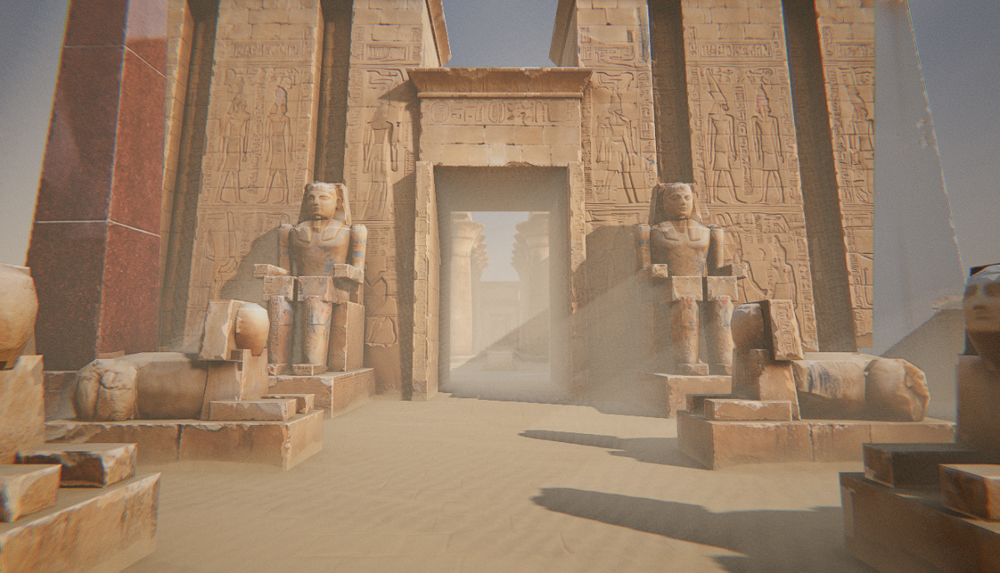

# Potemkin 3D

**AI-painted environments with view-aware texture atlases, surface relief, and real-time walkthroughs.**

Potemkin 3D extends [Trompe by Patch](https://github.com/Patch-gg/trompe). Start with ordinary UV-mapped geometry, paint camera views with image models, project those images back onto the mesh, and explore the result under real-time lighting. Potemkin adds tools for texture density, geometry fidelity, material response, and close-up presentation, with a Luxor temple and a New York loft as included scenes.



*A screenshot of the included Luxor WebGL viewer, with the controls hidden. The geometry is a procedural interpretation of Luxor Temple; the painted inscriptions and relief are generated imagery, not an archaeological reconstruction.*

## Try the included scenes

No API key or image generation is needed to view the baked scenes. With Python 3 installed:

```sh
git clone https://github.com/wrong-nebula/potemkin3D.git
cd potemkin3D
python3 -m http.server 8080 --bind 127.0.0.1 --directory deploy/potemkin3d
```

Open **http://localhost:8080/** for the loft or **http://localhost:8080/luxor/** for the temple. Serve that directory as the website root so the shared scene menu works.

In Luxor, use **WASD** to walk, **Shift** to run, and click or drag to look. **1–5** select viewpoints. **P** toggles carved depth, **J** cavity shadows, **O** weathering, **U** sand and dust, and **R** light shafts. The on-screen controls list the other effects.

## What comes from Trompe, and what Potemkin adds

The foundation is Patch's work: walkable-camera planning, clay and geometry-buffer renders, material-aware prompts, sequential view painting, seam compositing, quality-weighted UV projection, relighting, and GLB export. Potemkin is a derivative of that engine, not an independently invented replacement.

This comparison is against public upstream [`ba9ef76`](https://github.com/Patch-gg/trompe/tree/ba9ef76687f57eef157057c7592d26e59c805992), checked on 2026-11-17. Potemkin retains upstream Git history; subsequent local development is published as a consolidated commit under `wrong-nebula`. The following are implementation differences, not a claim of universal quality or speed improvements.

| Area | Public Trompe baseline | Potemkin additions and intended benefit |
| --- | --- | --- |
| Texture allocation | Uses the model's existing UV layout | Visibility-weighted and distance-weighted repacking; multi-page atlases and island splitting put more texels on surfaces players approach. |
| Camera selection | Greedy coverage of reachable surfaces, roofs, aerial views and holes | Optional detail-gain scoring, surface-directed candidates and paintability estimates; measure useful pixels rather than coverage alone. |
| Geometry fidelity | Prompts constrain the image model to the blockout | SAM-based face checks, a MoGe plane test, automatic shape naming and retry passes reduce paintings that replace a wall or prop with an invented scene. |
| Repairs | Fill unpainted holes | Target low-detail defects, isolate difficult parts and small props, then fill remaining slivers from nearby same-part colors. |
| Floors | Ground mainly painted through scene views | Dedicated overhead passes, world-space material tiling and an optional protected detail layer address grazing-angle blur and inconsistent scale. |
| Materials | Painted color with real-time scene lighting | Normal/roughness processing, AO baking, aligned height-derived normals and editable material presets add controllable surface response. |
| References | Text descriptions and model inputs | Scene look files, reference photographs and tone normalization provide reusable, place-specific material guidance. |
| Reliability | The documented baseline saves a run when it completes | Incremental per-view saves, resumable runs and browser recovery retain completed generation work. |
| Presentation | Authoring viewer and export | Capsule-based walking, standalone multi-scene website, streamed high-resolution textures and the Luxor relief/weathering/camera-effects viewer. |

Some options trade quality for memory, cost, or complexity. Surface-directed camera planning is experimental and is not always better. More atlas pages cannot recover detail absent from the generated views. The earlier measured examples in [ENGINE.md](ENGINE.md) are historical experiments, not a fresh benchmark against today's upstream or current model pricing.

## How the techniques fit together

### 1. Plan from where the scene will be seen

The engine samples walkable ground, places eye-height cameras, checks visibility, and selects overlapping views. Geometry buffers record surface position, normals, UVs and part identity. Additional cameras can cover roofs, ground and holes. The optional sharpness objective favors cameras that improve projected sampling density instead of simply covering more texels.

### 2. Spend texture resolution on useful surfaces

`layout.ts` repacks existing UV islands; it does not unwrap an arbitrary mesh. The `seen` layout reduces the allocation for hidden surfaces. The `near` layout also weights islands by player distance and joins compatible faces into strips. Multi-page packing divides a large scene among several atlases, cutting oversized islands when necessary while retaining a consistent scale across pages.

### 3. Paint views, preserve structure, and project

Image models receive a clay/state render, material instructions, part names and optional reference images. Earlier paint supplies context for later views. Compositing preserves known pixels and adjusts color drift at seams. Geometry checks reject or retry regions where the model replaces a surface. Projection favors views with better angle and distance, while cleanup and part-specific passes concentrate additional calls on remaining defects. A final local color fill covers otherwise unreachable slivers; it does not invent missing geometric detail.

### 4. Separate painted color from surface response

The pipeline aims for approximately unlit color by painting under overcast lighting. Normal, roughness and optional AO maps supply additional shading. Aligned-map processing derives normals from the same height field used for relief, with physical scale and slope limits controlled by material presets. Presets leave the painted atlas intact. See [material maps](docs/material-maps.md) for data conventions, persistence and limitations.

### 5. Make Luxor's carving read at close range

The Luxor viewer uses **parallax occlusion mapping (POM)**: the shader traces through a dedicated height texture to offset the apparent surface intersection. Color and material channels use the same displaced UVs. A second trace adds self-shadowing inside recesses. Island-boundary masks keep traces from sampling a neighboring packed surface; relief fades with distance and extreme grazing angles. This changes surface appearance, not mesh silhouettes, collision or cast-shadow geometry.

Low-resolution geometry/textures load first, then high-resolution material pages stream in. Color, normals and height switch together. Procedural edge wear, stone weathering, sand, airborne dust and light shafts build on the same scene. Camera effects include exposure adaptation, bloom, lens artifacts, depth of field, motion blur and color grading. These are adjustable presentation effects, not evidence of recovered physical detail.

The editable implementation is in [`experiments/luxor-view/`](experiments/luxor-view/), including [POM and height-map details](experiments/luxor-view/README.md).

## Author a scene

Use a current Node.js version supported by the pinned Vite dependencies, npm, and a browser with WebGL. GPU acceleration is recommended; the geometry checker can also use WebGPU.

```sh
npm ci
npx playwright install chromium  # needed for headless scripts
cp .env.example .env.local       # add your own FAL_KEY for generation
npm run dev
```

Open the URL printed by Vite, normally **http://localhost:5178**. Choose a sample or a UV-mapped, Y-up GLB, describe its materials, plan cameras, and then texture it. Named material parts improve the prompts. The local fal proxy reads the key server-side. Generation uses paid external model APIs; the included scene viewer, local map processing and ordinary tests do not need those calls.

A Luxor planning example:

```sh
node scripts/texture.mjs --look samples/luxor.look.json --id luxor-new \
  --first h3 --fill h3 --views 64 --cleanup 8 --finish \
  --layout near --pages 4 --atlas 4096 --plan-only
```

Review the plan before removing `--plan-only` to start paid generation. The public look file uses only the reference photos included with known licenses. It therefore differs from the historical input set used for the bundled scene. See [ENGINE.md](ENGINE.md) for all CLI options and generation workflows.

## Build and check

```sh
npm test
npm run build          # type-check and build the authoring application into dist/
npm run build:scenes   # rebuild both viewers using the included baked assets into dist-potemkin/
python3 -m http.server 8080 --bind 127.0.0.1 --directory dist-potemkin
```

The scene build uses existing GLBs and textures and makes no model calls. It keeps the source assets in `deploy/potemkin3d/`. Editing Luxor's viewer code is independent of regenerating its painted textures.

Height-processing tests additionally require NumPy and Pillow:

```sh
python3 -m unittest discover -s test -p 'height_maps_test.py'
```

## Project map

| Location | Contents |
| --- | --- |
| `src/core/` | Planning, geometry checks, atlas layout/projection, repairs, materials and export |
| `src/providers/` | fal model integrations and the browser segmentation model |
| `src/ui/`, `src/session.ts`, `src/api.ts` | Authoring interface, state and automation API |
| `src/demo/loftwalk.js` | Loft walkthrough and shared camera-effect shaders |
| `experiments/luxor-view/` | Editable temple viewer, POM, texture LOD, weathering and height processing |
| `experiments/material-lab/`, `experiments/benchmark/` | Material experiments and comparison tooling |
| `samples/`, `references/` | Procedural geometry, look files and attributed photo references |
| `deploy/potemkin3d/` | Complete baked loft/Luxor site and its shared menu |
| `scripts/`, `test/` | Automation, measurement, building and tests |

## Limitations and provenance

- Geometry still needs usable UVs. Repacking improves allocation; it is not general-purpose UV unwrapping.
- Generated textures can contain hallucinated inscriptions, inconsistent details, residual lighting and seams. A fidelity check reduces mistakes without guaranteeing accuracy.
- Atlas size, page count, POM and post-processing all consume GPU resources. Performance depends on resolution, hardware and enabled effects.
- Some runtime detail layers are shader effects and are not baked into a plain GLB export.
- The original full generation runs are not included. Finished assets are available, but exact texture regeneration is not reproducible from this repository alone. The viewer source was recovered from retained local Git trees; [PROVENANCE.md](PROVENANCE.md) records the source hashes.
- Experimental tools may require separately generated runs or additional Python dependencies. The README quick-start uses the self-contained baked scenes.

## License and credits

The code is **Apache-2.0**, retaining [Trompe's license](https://github.com/Patch-gg/trompe/blob/ba9ef76687f57eef157057c7592d26e59c805992/LICENSE). See [LICENSE](LICENSE), [NOTICE](NOTICE), and [THIRD_PARTY_NOTICES.md](THIRD_PARTY_NOTICES.md). Modified upstream source files identify the Potemkin changes. Patch's trademarks and branding remain Patch's; this project is not an official Patch release.

Trompe was made by [Patch](https://patch.gg). Potemkin's additions are maintained here by [wrong-nebula](https://github.com/wrong-nebula). The engine uses Three.js, three-mesh-bvh, Vite, Playwright, Transformers.js and model services through fal. Individual models and services retain their own terms.

Photographs and fonts have separate licenses and attribution. The Luxor reference credits identify the included CC BY-SA photos, cropping and tone adjustments. A photo whose source/license was unknown and the hangar's film-reference images are excluded. Scene media and screenshot licensing are described in [ASSET_LICENSES.md](ASSET_LICENSES.md); the code license does not relicense third-party material.
